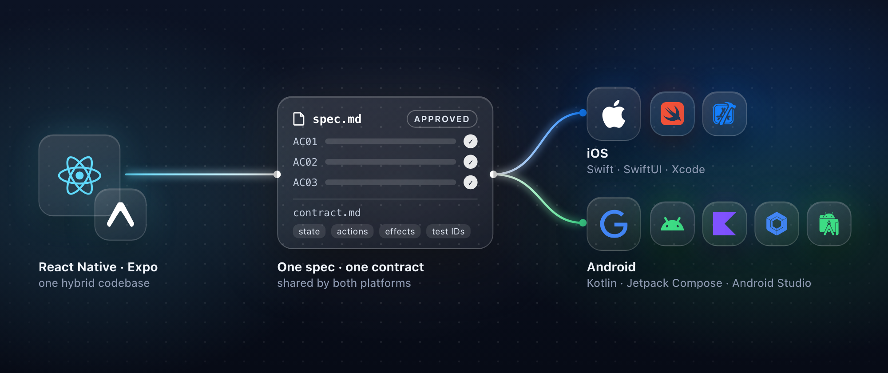
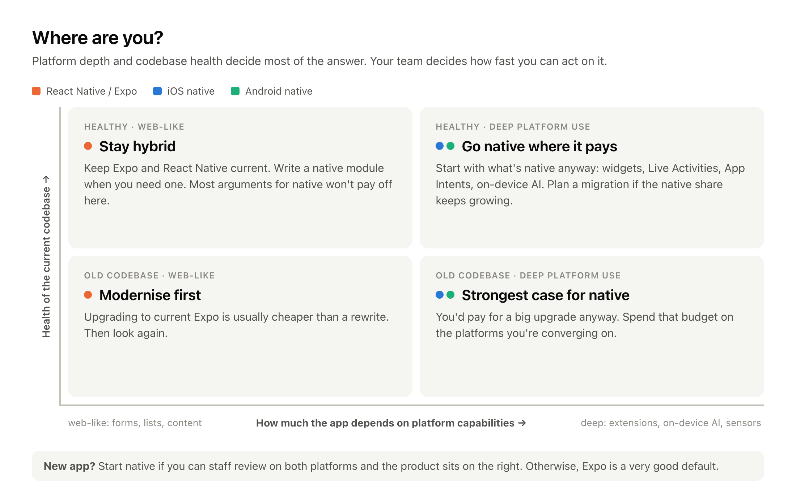
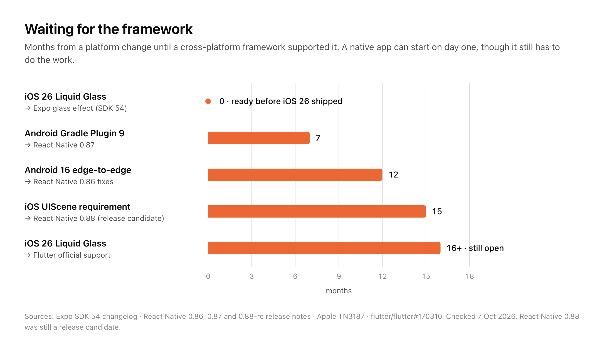
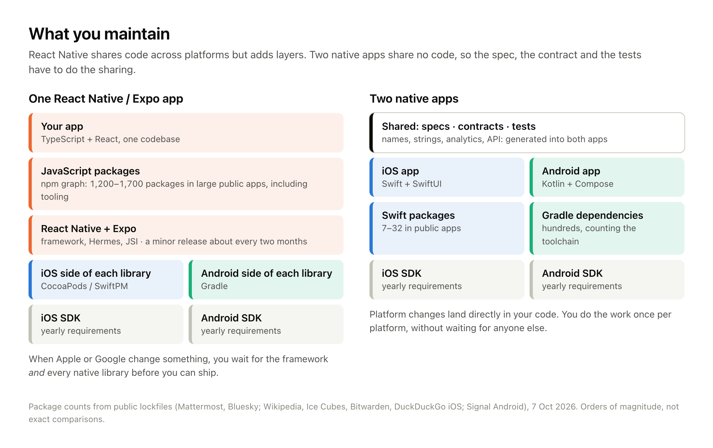
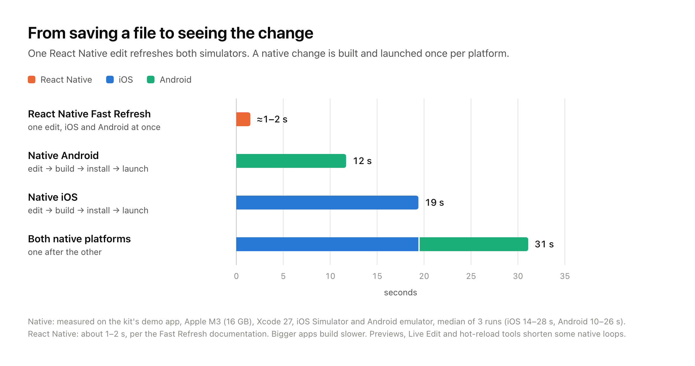
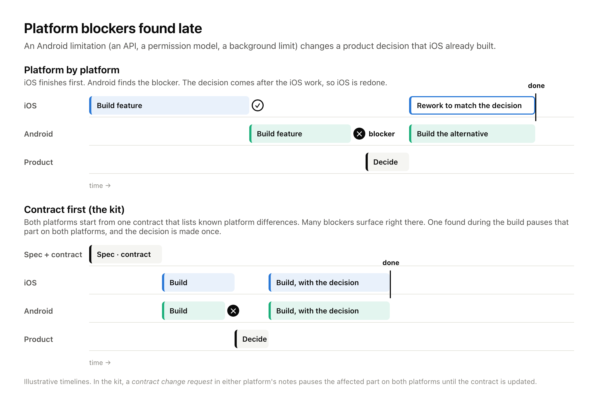
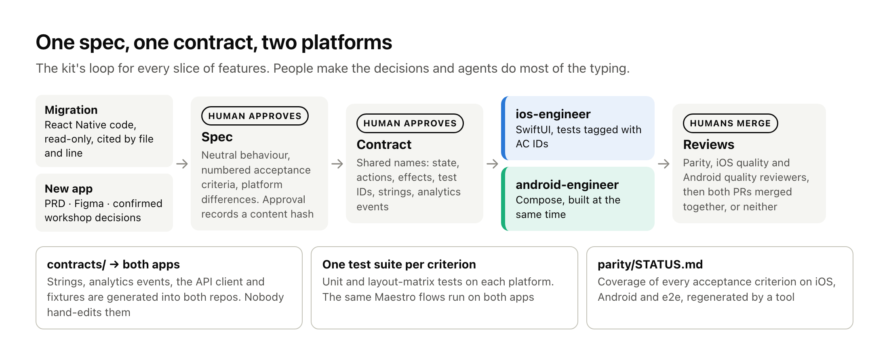
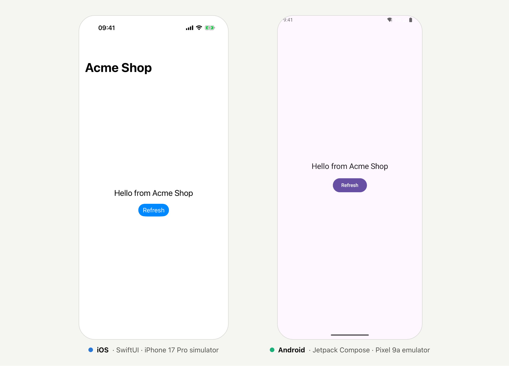
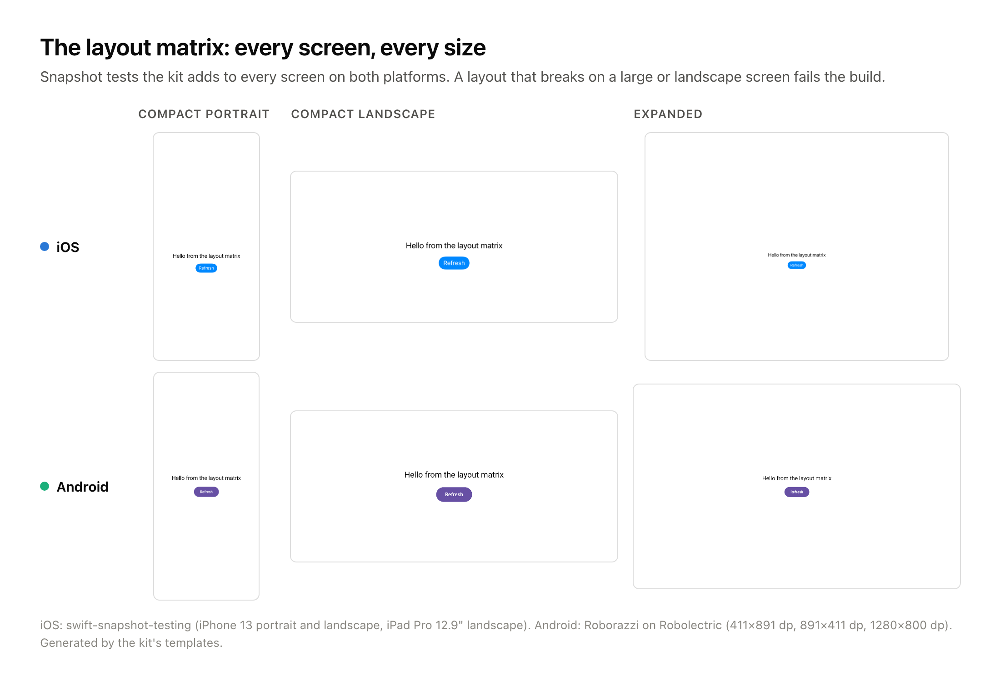
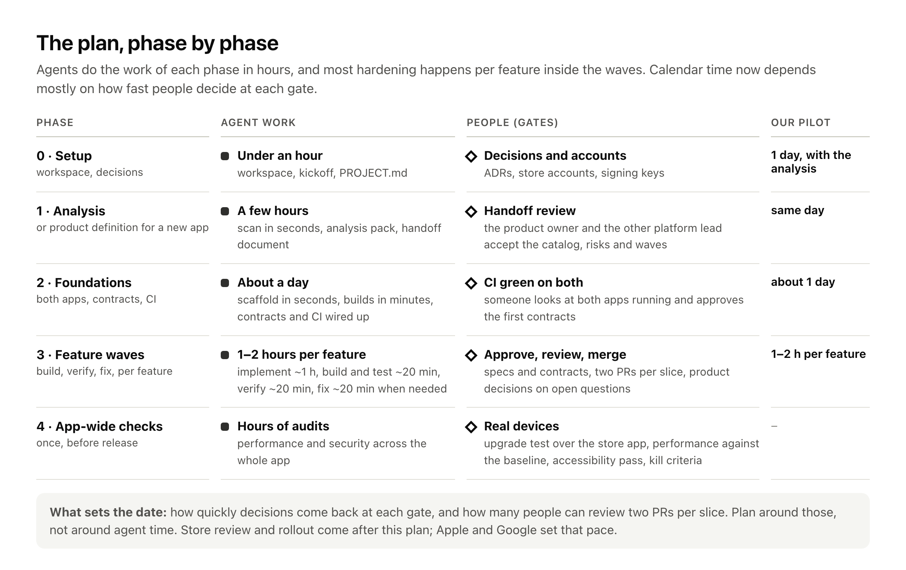

# Two native apps, one spec: choosing between React Native and native when agents write the code

*A decision guide for engineering leaders, with measured numbers, the trade-offs on both sides, and an open-source kit for
teams that decide to move.*



---

## TL;DR (for leaders)

- **Agents made writing code cheap. They didn't make keeping two apps equal cheap.** The cost moved from typing to
  specifying, verifying and coordinating. Whether native pays off depends on how well you handle that second part.
- **React Native still wins on some things.**
  - One feedback loop: one edit shows on both simulators in a second or two. In our measurements a native edit took 12–19 s per platform.
  - Over-the-air (OTA) updates.
  - One team with one skill set.
  - If your app is mostly forms, lists and content, and your Expo codebase is healthy, **stay**.
- **Native wins elsewhere.**
  - No waiting for a framework. Recent mandatory Apple and Google changes took React Native 7–15 months to fully support.
  - First-party agent tooling from Apple and Google.
  - A dependency graph that is one to two orders of magnitude smaller on iOS.
  - One fewer layer to upgrade.
- **Two native apps cost about 2.5–2.8× the tokens of a React Native app per feature** in our model. Building twice is
  the smaller part of that. Without a shared contract, finding and fixing the differences between the two apps costs
  almost as much as building the second one. The kit moves that work to the start, and comes out about 11% cheaper in
  tokens than two native apps built without it (roughly $6.75 instead of $7.74 per feature, against $2.80 for React
  Native).
- **The risks of two native apps are process problems:** two build loops, platform blockers found late, drift between
  the apps, more review, and no OTA. A process can address most of them: one spec, one contract, both platforms built in
  parallel, and a parity check for every acceptance criterion.
- **We open-sourced the kit we use for that process**, for migrations and for new apps. It starts with an analysis,
  which also tells you whether to move at all.

---

## 1. Why this question is back

For a decade, cross-platform frameworks have rested on one economic argument: build a feature once and ship it twice.
React Native, especially with Expo, made that argument strong. The framework is healthy:
- the New Architecture is the only architecture since [0.82](https://reactnative.dev/blog/2025/10/08/react-native-0.82);
- Hermes V1 is the default engine;
- React Native now has a neutral home in the React Foundation;
- Expo exposes SwiftUI and Jetpack Compose components directly.

Then coding agents became good enough to write and translate most of a feature. In September 2026 Shopify, one of
React Native's best-known champions, [announced it is moving its apps back to native](https://shopify.engineering/back-to-native).
Their argument wasn't that React Native is slow. It was that agents have shrunk the benefit of sharing an implementation,
while the benefits of building for each platform are still there. Their [Shop app migration](https://shopify.engineering/shop-app-migration)
reported going from proof of concept to the stores in 12 weeks with six core engineers.

The reaction was split, and fairly so. Critics pointed out that the React Native baseline hadn't moved to the New
Architecture, so some of the gains were the rewrite rather than the platform. Others noted that Shopify has the
staff to maintain its own libraries and native expertise, which most teams don't
([RedMonk](https://redmonk.com/kholterhoff/2026/09/22/shopify-native/), [InfoQ](https://www.infoq.com/news/2026/09/shopify-drops-react-native/)).
Shopify itself says native expertise was still essential, because generated code brought duplication and drift.

So the honest question isn't "is native better?". It's this: **for your app, your team and your codebase, do agents
change the economics enough to justify two apps, and if so, how do you keep two apps from drifting apart?**

---

## 2. Where are you?

Two things decide most of the answer: how much your app depends on platform capabilities, and how healthy the current
codebase is. A third, your team, decides how fast you can act on it.



- **Healthy codebase, web-like app (top left): stay hybrid.** Keep Expo current and write a native module when you need one.
  Most of this article's arguments for native won't pay off for you.
- **Old codebase, web-like app (bottom left): modernise first.** Upgrading to current Expo and React Native is usually
  cheaper than a rewrite. Then look again.
- **Healthy codebase, deep platform use (top right): go native where it pays.** Start with the parts that are native
  anyway (widgets, Live Activities, App Intents, on-device AI). Plan a migration if the native share keeps growing.
- **Old codebase, deep platform use (bottom right): the strongest case for native.** You'd pay for a big upgrade anyway.
  Spend that budget on the platforms you're converging on.
- **A new app:** start native if you can staff review on both platforms and the product leans right on the map.
  Otherwise, Expo is a very good default.

Three questions sharpen the position:

1. **How much of your "React Native" app is already native?** Count the native modules, config plugins, patched packages
   and extension targets. Every widget, Live Activity and App Intent is native code already.
2. **How much do you depend on OTA updates?** If shipping JavaScript fixes between store releases is how you run the
   business, losing it is a real cost (§3, §5).
3. **Who would review the native code?** Agents write it, but someone who knows each platform must still be able to say
   "this is wrong".

---

## 3. What React Native still does better

These are real advantages, and an article that waves them away isn't worth your time.

**One feedback loop for two platforms.** One Metro server feeds both simulators, so one edit shows on iOS and Android at
the same time, usually [in a second or two](https://reactnative.dev/docs/fast-refresh), keeping component state. It
is a big deal for agents: one that can see both simulators while it edits fixes layout problems in one pass, with one
build's worth of tokens. Natively, every UI change means two compile, install and launch cycles (§5).

**OTA updates.** [EAS Update](https://docs.expo.dev/eas-update/faq/) ships JavaScript and asset fixes without a store
review, with staged rollouts and rollback. Native apps can't: Apple's guideline 2.5.2 forbids downloading code that
changes features, and Google Play has a similar rule. Microsoft's hosted CodePush service ended with
[App Center's retirement](https://learn.microsoft.com/en-us/appcenter/retirement) in March 2025, so in practice Expo
is now the main hosted option.

**One team, one language, and often the web too.** One codebase can feed iOS, Android and the web. For a small team,
that's the difference between shipping and not shipping.

**Expo absorbs a lot of upgrade pain.** Continuous Native Generation rebuilds the native projects from configuration, and
the SDK cadence bundles framework, library and platform changes. Expo also helps teams move gradually: SDK 55's
[`expo-brownfield`](https://expo.dev/blog/expo-brownfield-how-to-add-expo-to-your-existing-native-app-without-a-rewrite)
embeds an Expo app inside a native one.

**Agents work in both directions.** The same agent capability that ports React Native to native can port native to React
Native. Coding agents don't, on their own, decide which way to go.

---

## 4. What native gives you

### No waiting for the framework

Apple and Google ship new platform behaviour every year, and some of it is mandatory:
- **Apple:** builds for the App Store must use the iOS 26 SDK
  ([since April 2026](https://developer.apple.com/news/upcoming-requirements/)). From
  [April 2027 they need the iOS 27 SDK](https://developer.apple.com/news/?id=k1mtkt1k), which makes the
  [UIScene lifecycle mandatory](https://developer.apple.com/documentation/technotes/tn3187-migrating-to-the-uikit-scene-based-life-cycle)
  and removes the Liquid Glass opt-out.
- **Google Play:** apps must [target API 36](https://developer.android.com/google/play/requirements/target-sdk). Android 16
  [enforces edge-to-edge and ignores orientation locks on large screens](https://developer.android.com/about/versions/16/behavior-changes-16),
  and Android 17 [removes the opt-out](https://developer.android.com/blog/posts/prepare-your-app-for-the-resizability-and-orientation-changes-in-android-17).

A native team does this work as soon as the SDK ships. A cross-platform team does the same work, but only after the
framework and every native library they use have caught up.



<!-- png: t1-framework-lag -->
| Platform change | Framework support | Months |
|---|---|---|
| iOS 26 Liquid Glass (Sept 2025) | Expo `expo-glass-effect`, shipped with SDK 54 before iOS 26 was released | 0 |
| Android Gradle Plugin 9 (Jan 2026) | React Native 0.87 (Aug 2026), with opt-outs scheduled for removal | 7 |
| Android 16 edge-to-edge (Jun 2025) | React Native 0.86 edge-to-edge fixes (Jun 2026) | 12 |
| UIScene requirement announced (Jun 2025) | React Native 0.88 release candidate (Sept 2026) | 15 |
| iOS 26 Liquid Glass (Jun 2025 announcement) | Flutter official support: still open | 16+ |

Two caveats keep this fair. First, the lag isn't always long: Expo had a Liquid Glass component ready before iOS 26
shipped. Second, some new design work isn't even stable natively yet: Material 3 Expressive is still in alpha in Compose.
But for mandatory changes, a framework app can't ship until its whole dependency tree is ready, and that wait is the cost.

### First-party tools for agents

Apple and Google now build agent tooling into their own IDEs and CLIs:
- **Xcode 26.3** [ships Claude Agent and Codex built in](https://www.apple.com/newsroom/2026/02/xcode-26-point-3-unlocks-the-power-of-agentic-coding/)
  and [exposes Xcode to outside agents over MCP](https://developer.apple.com/documentation/xcode/giving-external-agents-access-to-xcode).
- **Xcode 27** lets agents run tests, Previews and the Simulator.
- **Google's Android CLI** ([1.0 since May 2026](https://android-developers.googleblog.com/2026/04/build-android-apps-3x-faster-using-any-agent.html))
  ships official [Android agent skills](https://github.com/android/skills) and a searchable knowledge base.
- **Android Studio** has an agent mode.

React Native has good tooling too (the Expo MCP server, Callstack's agent tools), but it comes from companies around the
framework, not from Apple and Google.

There's a quieter benefit as well. Apple's and Google's documentation, sample code, WWDC and I/O sessions, and official
skills all describe Swift and Kotlin. An agent working natively reads the same sources the platform teams write. One
thing we *won't* claim: that agents are simply better at Swift and Kotlin than at TypeScript. The benchmarks are thin
and point both ways. Google's [Android Bench](https://developer.android.com/bench) even includes a "convert React
Native to Android" task that most frontier models still fail. That result is one reason a structured process matters.

### Fewer layers, fewer dependencies, less debt



A React Native app carries three dependency graphs: npm, CocoaPods or SwiftPM, and Gradle. Counting public lockfiles
for this article:

<!-- png: t2-dependencies -->
| App | What we counted | Packages |
|---|---|---|
| Mattermost (React Native) | unique npm packages in the lockfile, plus 160 CocoaPods | 1,270 |
| Bluesky (React Native and web) | unique npm packages in the lockfile | 1,716 |
| Wikipedia, Ice Cubes, Bitwarden, DuckDuckGo (iOS) | Swift packages in `Package.resolved` | 7–32 |
| Signal (Android) | Gradle artifacts, including build tooling | 758 |

The comparison isn't one-sided: Android's Gradle graph runs to hundreds of artifacts once you count the toolchain. But
the npm graph is where the 2025–2026 supply-chain attacks happened:
- the [chalk/debug compromise](https://semgrep.dev/blog/2025/chalk-debug-and-color-on-npm-compromised-in-new-supply-chain-attack);
- the [Shai-Hulud worms](https://www.cisa.gov/news-events/alerts/2025/09/23/widespread-supply-chain-compromise-impacting-npm-ecosystem);
- the [axios compromise](https://www.cisa.gov/news-events/alerts/2026/04/20/supply-chain-compromise-impacting-axios-node-package-manager);
- at least three incidents in React Native packages specifically
  ([one example](https://threats.wiz.io/all-incidents/npm-supply-chain-attack-compromises-16-popular-react-native-and-gluestack-packages)).

Native ecosystems have had incidents too (CocoaPods trunk, MavenGate), but we found nothing at that scale in 2025–2026.

The framework layer also has its own upgrade cycle. React Native ships a minor version about every two months and
[supports the latest three](https://github.com/reactwg/react-native-releases/blob/main/docs/support.md). In the
[State of React Native 2025 survey](https://results.stateofreactnative.com/), the top pain point was "ecosystem and
dependencies". On [reactnative.directory](https://reactnative.directory), about a third of listed libraries are flagged
unmaintained. Moving to the New Architecture took real work even for strong teams:
- [Shopify](https://shopify.engineering/react-native-new-architecture) saw temporary regressions;
- [Discord and Software Mansion](https://swmansion.com/blog/what-it-actually-takes-to-migrate-discord-to-react-native-s-new-architecture)
  spent close to a year on iOS alone.

Native has churn as well: Swift 6 concurrency, Kotlin K2, the Android Gradle Plugin 9 and 10 changes, and Apple's and
Google's yearly deadlines. The difference is that you face that churn once per platform, not once per platform plus once
for the framework.

### Longevity

Frameworks and their services do disappear:
- Xamarin's [support ended in May 2024](https://dotnet.microsoft.com/en-us/platform/support/policy/xamarin);
- PhoneGap Build closed;
- CodePush closed.

React Native is well funded, so its risk is churn rather than abandonment. Still, the UI framework of a SwiftUI or
Compose app belongs to the platform vendor itself, and that's the safest dependency you can have.

---

## 5. What two native apps cost

This is the part most "go native" posts skip.

### Two feedback loops

We measured the edit-to-running loop on a small app the kit generates. The setup was an Apple M3 with 16 GB, Xcode 27,
the iOS Simulator and an Android emulator, with the median of three runs.



<!-- png: t3-feedback-loop -->
| Loop | Time |
|---|---|
| React Native Fast Refresh, both platforms at once | about 1–2 s (React Native docs) |
| Native Android: edit, build, install, launch | 12 s median (range 10–26 s) |
| Native iOS: edit, build, install, launch | 19 s median (range 14–28 s) |
| Both native platforms, one after the other | about 31 s |

Bigger apps take longer. Large modular iOS projects can wait a long time just
[planning a build](https://forums.swift.org/t/slow-incremental-builds-because-of-planning-swift-module/84803) on
Xcode 26. Some native tools narrow the gap:
- SwiftUI Previews and Compose Previews;
- Android Studio's Live Edit;
- InjectionNext on iOS.

But each covers only some kinds of change. For an agent this cost is real: more waiting and more tokens per visual check.
Shopify reported the same: driving simulators took minutes while code changes took seconds, so they gave their
agents a headless tool to navigate and inspect the app's state instead.

### Platform blockers found late

This is the one that hurts most in practice. A feature is built and approved on iOS. Then Android turns out to need a
different approach, perhaps because of a missing API, a permission model or a background limit. Now there's a
product decision to make, and the iOS work may have to be redone to match the alternative. Work done one platform at a
time finds these problems late.



### Drift, review load and tokens

- **Drift:** two codebases slowly disagree, through different validation rules, a missing analytics event, a different
  error message or different accessibility labels. Nobody notices until a customer or a dashboard does.
- **Review load:** agents raise output, and the bottleneck moves to review. In one large telemetry study, PR review time
  [almost doubled](https://www.faros.ai/blog/ai-software-engineering), and Google's
  [DORA 2025 report](https://cloud.google.com/blog/products/ai-machine-learning/announcing-the-2025-dora-report) links AI
  use to higher throughput but lower delivery stability. With two apps, there are two PRs per feature.
- **Tokens:** building twice is only part of it. Without a shared contract, comparing two apps and fixing their
  differences costs almost as much again. In our model that's about 2.8× the tokens of React Native per feature, or 2.5×
  with the kit's process. §8 breaks it down and compares it with a single native app.

### No OTA, and the need for native expertise

Without OTA, a fix waits for review. Apple says
[90% of submissions are reviewed in under 48 hours](https://developer.apple.com/distribute/app-review/), and trackers
like [Runway's](https://www.runway.team/appreviewtimes) show typical totals of around nine hours, with occasional
multi-day outliers. Native teams make up for this with feature flags, remote configuration and server-driven UI.

And somebody on the team must know each platform well enough to reject plausible-looking code.

---

## 6. What agents changed, and what they didn't

Agents changed the cost of producing code. The research on how much is mixed:
- [METR's 2025 trial](https://arxiv.org/pdf/2507.09089) found experienced developers 19% *slower* with early-2025 tools.
- [Google's internal trial](https://arxiv.org/abs/2410.12944) found engineers about 21% faster.
- A [field study at Microsoft, Accenture and a Fortune 100 company](https://papers.ssrn.com/abstract=4945566) measured 26% more completed tasks.
- [METR's 2026 follow-up](https://metr.org/blog/2026-02-24-uplift-update/) leans positive, but METR itself treats it as weak evidence.

Nobody credible measures 10×. What is consistent is *where* the cost goes: specifying what to build, checking it,
reviewing it and keeping things consistent.

That's also what Shopify's write-up says once you look past the headline. What they share between platforms now is not
code but **knowledge**: specifications, tests, review checkpoints and parity checks. That is the core idea of this
article:

> **When code is cheap, share the spec, the contract and the tests, and let each platform have its own code.**

---

## 7. How the kit turns the two-app tax into a process

We built an open-source kit for exactly that: a workspace of guidelines, playbooks (agent skills), subagents, templates
and dependency-free tools. You put it next to your repositories and point an agent at it. It supports two modes:
**migration** (rewrite a React Native or Expo app) and **new app** (start from product docs, Figma and workshops).



Here is how it answers each cost from §5, including the ones it doesn't solve:

<!-- png: t4-kit-mapping -->
| The two-app cost | What the kit does | What's left to you |
|---|---|---|
| Two feedback loops | Both apps are generated with mirrored modules. The agents build in parallel. Unit and layout-matrix snapshot tests catch many problems without driving a simulator. The app is shown running once per slice, not after every edit | Your build times |
| Platform blockers found late | A contract (state, actions, effects, test IDs, platform differences) is agreed before either agent starts. A *contract change request* pauses the affected part on both platforms, and the decision is made once | The product decision itself |
| Drift | The same names in both repos. Strings, analytics events and the API client are generated into both apps from one `contracts/` folder. Every acceptance criterion needs a test on both platforms, and a parity report checks it | Reviewing what the report flags |
| Review load | Three agent reviewers per slice (parity, iOS quality, Android quality), one review pass per slice, and both PRs merged together | Human code review |
| Needing native expertise | 26 pinned platform skills (Apple-focused SwiftUI skills, Google's official Android skills, build-performance skills) with explicit precedence rules. The quality reviewers load them | At least one person per platform who can say "no" |
| Users' data on the device | A data-migration plan and an upgrade test, so users stay signed in after the update | — |
| Rewrite risk | Analysis first, then a gate. Ship when at parity. Vertical slices. Risky features (payments, auth, data migration) get their own full loop | Scope discipline |
| No OTA | Not solved: flags and remote config live in the contracts, and guideline 11 covers release cadence | Your release process |

### What it looks like

**Both apps come from templates and run in minutes.** One command generates an XcodeGen iOS project with a local Swift
package, and an Android project with Gradle convention plugins, Hilt and Navigation 3. Both include a sample feature,
layout-matrix tests and CI. On our machine:
- generation took 4 s;
- the first clean builds took 95 s (iOS) and 50 s (Android).

```text
$ node tools/scaffold-native.mjs --name "Acme Shop" --bundle-id com.acme.shop
✔ ios/: 28 files from templates/native/ios
✔ contracts/strings/en.json: added app.name, common.refresh
✔ ios/AcmeShop.xcodeproj generated by XcodeGen
✔ android/: 39 files from templates/native/android
✔ contracts/sync.config.json: Android analytics → package com.acme.shop.core.analytics.generated
✔ android/: Gradle wrapper 9.8.0 (distribution checksum pinned)
```



**The same shape on both sides.** State, actions and effects have the same names in both apps, so a reviewer, human or
agent, can compare them line by line:

```swift
// iOS: FeatureHome/HomeViewModel.swift
public func onAction(_ action: HomeAction) {
    switch action {
    case .appeared:
        guard !didLoad else { return }  // idempotent: .task runs again on every appear
        didLoad = true
        load()
    case .refreshTapped:
        load()
        effects.send(.scrollToTop)
    }
}
```

```kotlin
// Android: feature/home/HomeViewModel.kt
fun onAction(action: HomeAction) {
    when (action) {
        // idempotent: LaunchedEffect runs again after configuration changes
        HomeAction.Appeared -> {
            if (!didLoad) {
                didLoad = true
                load()
            }
        }
        HomeAction.RefreshTapped -> {
            load()
            _effects.trySend(HomeEffect.ScrollToTop)
        }
    }
}
```

**Shared things are generated, never copied by hand.** One string file becomes typed accessors on iOS and resources on
Android. Analytics events and the OpenAPI client work the same way.

`contracts/strings/en.json`:

```json
{ "app.name": "Acme Shop", "common.refresh": "Refresh" }
```

```swift
// generated: L10n.swift
public static var commonRefresh: String { tr("common.refresh") }
```

```xml
<!-- generated: strings.xml -->
<string name="common_refresh">Refresh</string>
```

**Every acceptance criterion is traced to a test on both platforms.** Specs number their criteria, and tests carry the
ID:

```swift
// AC: HOME-GREETING-AC01
@Test("appeared loads the greeting once")
func appearedLoadsOnce() async throws { … }
```

The parity report then shows what's covered and what isn't. This is real output from the demo app, with the paths shortened:

```text
AC coverage: iOS 2/3 (67%) · Android 2/3 (67%) · e2e 0/1 (0%)

| AC                 | Levels | iOS tests                        | Android tests                   |
|--------------------|--------|----------------------------------|---------------------------------|
| HOME-GREETING-AC01 | unit   | HomeViewModelTests.swift:18      | HomeViewModelTest.kt:24         |
| HOME-GREETING-AC02 | ui     | HomeLayoutMatrixTests.swift:11   | HomeLayoutMatrixTest.kt:15      |
| HOME-GREETING-AC03 | e2e    | ✖                                | ✖                               |
```

**Every screen renders at any size, on both platforms.** Android 17 and iOS 27 both stop honouring orientation locks in
resizable environments. The kit makes a "layout matrix" of snapshot tests part of every screen: compact portrait,
compact landscape and expanded.



---

## 8. Effort and cost

We'd rather give you a model you can check and adjust than a headline number.

### What the tokens cost, by approach

Agents bill by the token, and the approach you choose changes how many you use. The chart compares one feature (one
screen or flow, about ten acceptance criteria) built five ways:
- a React Native app, with one implementation agent and one code review;
- one native app (iOS or Android), with the same simple setup and no kit;
- two native apps without the kit: build both, then compare them and fix the differences;
- two native apps through the kit's default slice mode;
- two native apps through the kit's full per-feature loop.

Every approach also includes what happens after the first pass: fixing what the review finds and, now and then, redoing
work when a late blocker changes a decision.


<!-- png: t6-tokens -->
| Per feature | Coding | Spec and contract | Reviews | Fixes & rework | Total | vs React Native | Sonnet 5.5 |
|---|---|---|---|---|---|---|---|
| React Native app | 3.6M | — | 0.9M | 1.2M | **5.7M** | — | $2.80 |
| One native app, no kit | 3.3M | — | 0.9M | 1.0M | **5.2M** | 0.9× | $2.55 |
| Two native apps, no kit | 6.5M | — | 1.8M | 7.6M | **16.0M** | 2.8× | $7.74 |
| Two native apps, kit slice mode | 8.4M | 2.1M | 2.2M | 1.5M | **14.2M** | 2.5× | $6.75 |
| Two native apps, kit feature mode | 8.4M | 2.3M | 4.1M | 1.5M | **16.3M** | 2.8× | $7.85 |

How to read it:

- **One native app costs about the same as the React Native app** (0.9×). Agents don't charge extra for Swift or
  Kotlin. You pay per platform you build, and a single native app covers only one.
- **Building two native apps is the cheap part.** The two implementations and their code reviews come to 8.4M tokens,
  1.5× the React Native app.
- **Keeping two apps equal costs almost as much again.** Without a shared contract, two apps built from the same ticket
  end up different: copy, analytics names, test IDs, validation, empty and error states. Someone has to compare them,
  chat with an agent for every difference, and redo one platform when a late blocker changes a decision. With our
  assumptions (four differences per feature, and a late blocker on one feature in five), that's another 7.6M tokens.
  The total is 16.0M, or 2.8×.
- **The kit moves that cost to the start, and makes it smaller.**
  - The spec, the contract, the richer instructions and the platform reviews add 4.3M tokens up front.
  - Finding and fixing differences then drops from 7.6M to 1.5M. Names, strings and analytics are generated from one
    contract, the contract settles platform differences before any code is written, and the parity review lists what's
    left in a single pass.
  - Net result in slice mode: 14.2M, about 11% fewer tokens (13% cheaper) than two native apps without the kit.
  - Feature mode costs about the same as working without the kit, so keep it for risky features.
- **Whether the kit saves tokens depends on how much your two apps would drift.** The break-even chart below varies that
  one assumption:
  - below about two differences per feature, building twice without the kit costs fewer tokens;
  - above two, the kit does, and the gap grows with every difference.
- **Tokens are the smaller part of the saving.** Behind every difference fixed without the kit is a person: they notice it,
  decide which platform is right, and write the prompt. The contract and parity report do most of that work. And the
  differences nobody notices ship to users. Neither appears in a token count.
- **Across a whole app it's hundreds of dollars, not thousands.** For 40 features at Sonnet 5.5 list prices, that's about:
  - $110 for React Native;
  - $100 for one native app;
  - $310 for two native apps without the kit;
  - $270 for two native apps with the kit (slice mode).
  At Opus 5.5 prices, each figure is about 60% higher.
- **Most of these tokens are cache reads.** Every turn of an agent session re-sends its whole context, and most of it
  comes from the prompt cache at a fraction of the normal input price. So the instructions each agent has to read matter
  more than you'd expect. It's one reason the kit keeps its instruction files short and loads platform skills only where
  they're needed.


**This is a model, not a measurement.** What we measured is the kit context each role reads (its agent definition,
guidelines, preloaded skills, playbook and templates), from 11k to 30k tokens per role. Without the kit, an implementation
session reads only the project's own instructions, which we put at 10k tokens. What we assumed, the same way for every approach:
- a 15k-token agent harness;
- each difference or bug found after review costs one fix chat: 12 turns with about 60k tokens of code in context;
- four differences per feature without a contract, one with the kit (from the parity review), and one bug fix per
  feature for React Native and a single native app;
- a late blocker that forces one platform to be redone on one feature in five without the kit, and one in twenty with it
  or with React Native;
- 40k tokens of average working context for an implementation session, and 20–35k for a single-feature review (more for a slice);
- 50–55 turns per implementation session and 20–35 per review;
- 400 output tokens per turn;
- 90% of input served from the prompt cache.

The model is a short file, [`token-model.js`](https://github.com/YOUR-ORG/hybrid-to-native-kit/blob/main/blog/2026-10-native-or-hybrid/src/token-model.js),
so you can change any assumption. Better still, measure your first slice with your agent's usage report and replace
the assumptions with your own numbers.

### Agent time and people time

With agents, the work inside each phase takes hours or days, not weeks. These are the numbers from our pilot on a real
React Native app:
- **Setup and the full analysis:** one day.
- **Foundations:** about one more day. Both native apps were scaffolded and building, with contracts and CI in place.
- **A feature:** one to two hours of agent time. That breaks down as:
  - about an hour to implement it;
  - 20 minutes to build and test;
  - 20 minutes to verify it;
  - about 20 minutes to fix what the verification found, when it found something.
  Some features had nothing to fix and were done in about an hour. The demo-account feature, for example, was ready for
  QA well inside that range, with only its real API connection and a few edge cases left.

Hardening didn't wait for the end. Each feature was verified right after it was built, which is how the kit's slices
work anyway: tests, layout-matrix snapshots, and the parity and quality reviews run per slice. What's left for the end
is the checks that only make sense once, across the whole app: the upgrade test over the store app, performance against
the baseline, and an accessibility pass on real devices.

The per-feature number turns into a simple estimate for the biggest phase: **the features in your catalog (one contract
each) × one to two hours**. For a 40-feature app, that's 40–80 agent-hours, or about five to ten working days for one
person orchestrating the agents.


The waterfall leaves out something that agents don't shorten: the gates between phases. At each one, people decide. The
matrix shows what the agents do and what waits on people:



What sets the date is everything that waits on people:
- **Decisions at each gate:** the product owner accepting the analysis, approving specs and contracts, and answering
  open questions.
- **Review capacity:** two PRs per slice, reviewed by people who know each platform.
- **The app-wide checks on real devices** before release.

Apple's and Google's review and rollout come after this plan. No engineer controls them, so we left them out.

So plan around decision speed and review capacity, not agent speed. The practical method:

1. **Do the analysis first.** For a migration, the kit's scanner maps routes, dependencies, stored data, API calls,
   analytics and native modules in seconds. A tech lead then turns that into a feature catalog, risks and waves. For a
   new app, the same phase works from your PRD, designs and workshop notes. That gives you the number of features, which
   is what everything scales with.
2. **Build the first vertical slice** (launch, log in, main screen) on both platforms.
3. **Measure it, and replace our numbers with yours:**
   - agent hours and tokens per feature (compare them with the model above);
   - how long each gate waited for a person;
   - human review hours per slice;
   - review rounds and parity gaps.
   The kit's slice reviews and parity report give you most of these numbers.
4. **Multiply by the catalog**, then add the app-wide checks.

For an outside reference: Shopify's Shop app took six core engineers twelve weeks, from proof of concept to the stores.
That was with a strict checkpoint process, a team with deep native expertise, and a working app to port from.

### Choosing a strategy to reduce debt

<!-- png: t5-strategies -->
| Strategy | Debt it removes | Cost and risk | Best when |
|---|---|---|---|
| Stay and modernise (current Expo, New Architecture) | Old framework versions, stale libraries | Low to medium; keeps every layer | Web-like app, healthy team, OTA matters |
| Brownfield / strangler fig (native shell, remaining screens in Expo) | The framework layer, gradually, screen by screen | You maintain both stacks until done | Big app that can't freeze; high-traffic screens first |
| Native rewrite at parity (the kit's default) | The framework layer and its dependency graph | Highest upfront; controlled by the analysis gate, slices and parity checks | Deep platform use, or a big upgrade is due anyway |
| Shared logic, native UI (Kotlin Multiplatform, Swift for Android, Skip) | UI framework layer, keeps one logic codebase | New toolchain and its own churn | Heavy business logic, native-minded team |

Big-bang rewrites have a [bad reputation](https://www.joelonsoftware.com/2000/04/06/things-you-should-never-do-part-i/)
for good reasons: they throw away years of fixes and freeze the product. The kit's answer is to treat the old app as
*evidence*, not as the specification. Every behaviour goes into a spec with numbered acceptance criteria, odd behaviour
is raised as a question instead of being copied, and nothing ships until both apps reach parity. If you can't freeze
your product, combine it with a [strangler](https://martinfowler.com/bliki/StranglerFigApplication.html) approach.

---

## 9. Try it

The kit is open source: **[github.com/runtimerevolution/hybrid-to-native](https://github.com/runtimerevolution/hybrid-to-native)**.
It works with Claude Code out of the box, and with other agents that read `AGENTS.md` (Codex, Cursor, Gemini).

**Migrating a React Native / Expo app:**

```bash
git clone https://github.com/runtimerevolution/hybrid-to-native
hybrid-to-native-kit/tools/init-workspace.sh ~/Projects/shop-native \
  --hybrid git@github.com:acme/shop-rn.git
cd ~/Projects/shop-native && claude
```

```text
/kickoff analyst                 → checks the setup, pins the production version, fills PROJECT.md
/rn-analyze                      → inventory, feature catalog, data on the device, risks, analysis handoff
/spec-feature AUTH-LOGIN         → a platform-neutral spec with numbered acceptance criteria
node tools/spec.mjs approve AUTH-LOGIN --by "Product owner"
/scaffold-native                 → both native apps, built, tested and running
/implement-slice SLICE-01        → contracts, iOS ∥ Android agents, one review pass
node tools/parity-report.mjs --out parity/STATUS.md
```

**Starting a new app:**

```bash
hybrid-to-native-kit/tools/init-workspace.sh ~/Projects/shop-native --new
```

Then `/kickoff`, then `/define-product`. That indexes your PRD and Figma files and runs structured workshops with the
product owner, in which the agent asks, proposes and records decisions. It ends with a product handoff before any code
is written.

Anyone on the team can run `/kickoff stakeholder`, `/kickoff engineer` or `/kickoff qa` to see the process from their
role's point of view.

---

## 10. When not to do this

- **Your app is web-like and your Expo codebase is healthy.** You'd pay for two apps and get little that users notice.
- **OTA updates are central to how you operate.** Weekly content or logic changes shipped as JavaScript are hard to give up.
- **Nobody can review native code on one of the platforms**, and you can't hire or train someone. Agents need a human
  who can say no.
- **Your web app shares a lot of code with the mobile app.** Leaving React Native would cut that link.
- **You can't freeze anything and you can't afford a parallel effort.** Modernise first, or go brownfield.

---

## Closing

Coding agents didn't settle "native or cross-platform". They moved the question. When writing code was the bottleneck,
sharing code was the best way to save effort. Now that checking and coordinating are the bottleneck, the most valuable
things to share are the spec, the contract and the tests. Teams that get that right can have two native apps without
paying twice for everything. Teams that don't will get two apps that drift apart, and wish they'd stayed with React Native.

Start with the analysis. It's the cheapest part, and it might tell you not to move.

---

### Sources and notes

Figures were checked on 7 October 2026. Our own measurements come from the kit's generated demo app on an Apple M3
(16 GB), macOS 27, Xcode 27, the iOS Simulator (iPhone 17 Pro) and an Android emulator (Pixel 9a), median of three runs.

**Industry moves**
- Shopify: [back to native](https://shopify.engineering/back-to-native) ·
  [Shop app migration](https://shopify.engineering/shop-app-migration) ·
  [New Architecture migration (2025)](https://shopify.engineering/react-native-new-architecture)
- Reactions: [RedMonk](https://redmonk.com/kholterhoff/2026/09/22/shopify-native/) ·
  [InfoQ](https://www.infoq.com/news/2026/09/shopify-drops-react-native/)
- Airbnb: [sunsetting React Native (2018)](https://medium.com/airbnb-engineering/sunsetting-react-native-1868ba28e30a)

**React Native and Expo**
- React Native: [0.82](https://reactnative.dev/blog/2025/10/08/react-native-0.82) ·
  [0.86](https://reactnative.dev/blog/2026/06/11/react-native-0.86) ·
  [0.87](https://reactnative.dev/blog/2026/08/11/react-native-0.87) ·
  [support policy](https://github.com/reactwg/react-native-releases/blob/main/docs/support.md) ·
  [Fast Refresh](https://reactnative.dev/docs/fast-refresh)
- Expo: [SDK 54](https://expo.dev/changelog/sdk-54) · [SDK 58 beta](https://expo.dev/changelog/sdk-58-beta) ·
  [brownfield](https://expo.dev/blog/expo-brownfield-how-to-add-expo-to-your-existing-native-app-without-a-rewrite) ·
  [EAS Update](https://docs.expo.dev/eas-update/faq/)
- Ecosystem: [State of React Native 2025](https://results.stateofreactnative.com/) ·
  [reactnative.directory](https://reactnative.directory) ·
  [Discord's New Architecture migration](https://swmansion.com/blog/what-it-actually-takes-to-migrate-discord-to-react-native-s-new-architecture) ·
  [App Center retirement](https://learn.microsoft.com/en-us/appcenter/retirement)

**Platform changes**
- Apple: [upcoming requirements](https://developer.apple.com/news/upcoming-requirements/) ·
  [iOS 27 SDK requirement](https://developer.apple.com/news/?id=k1mtkt1k) ·
  [TN3187 UIScene](https://developer.apple.com/documentation/technotes/tn3187-migrating-to-the-uikit-scene-based-life-cycle)
- Android: [Android 16 behaviour changes](https://developer.android.com/about/versions/16/behavior-changes-16) ·
  [Android 17 resizability](https://developer.android.com/blog/posts/prepare-your-app-for-the-resizability-and-orientation-changes-in-android-17) ·
  [target API](https://developer.android.com/google/play/requirements/target-sdk) ·
  [16 KB pages](https://developer.android.com/guide/practices/page-sizes) ·
  [AGP roadmap](https://developer.android.com/build/releases/gradle-plugin-roadmap)
- Flutter: [Liquid Glass issue](https://github.com/flutter/flutter/issues/170310)

**Agent tooling and benchmarks**
- Apple: [Xcode 26.3](https://www.apple.com/newsroom/2026/02/xcode-26-point-3-unlocks-the-power-of-agentic-coding/) ·
  [external agents in Xcode](https://developer.apple.com/documentation/xcode/giving-external-agents-access-to-xcode)
- Google: [Android CLI](https://android-developers.googleblog.com/2026/04/build-android-apps-3x-faster-using-any-agent.html) ·
  [Android skills](https://github.com/android/skills) · [Android Bench](https://developer.android.com/bench)
- Other: [SWE-Bench Mobile](https://arxiv.org/abs/2602.09540)

**Productivity and cost**
- Trials and studies: [METR 2025](https://arxiv.org/pdf/2507.09089) ·
  [METR 2026 update](https://metr.org/blog/2026-02-24-uplift-update/) ·
  [Google trial](https://arxiv.org/abs/2410.12944) ·
  [Cui et al.](https://papers.ssrn.com/abstract=4945566)
- Industry reports: [DORA 2025](https://cloud.google.com/blog/products/ai-machine-learning/announcing-the-2025-dora-report) ·
  [Faros AI](https://www.faros.ai/blog/ai-software-engineering)
- Costs and review times: [Anthropic pricing](https://platform.claude.com/docs/en/about-claude/pricing) ·
  [Apple App Review](https://developer.apple.com/distribute/app-review/) ·
  [Runway review times](https://www.runway.team/appreviewtimes)

**Supply chain and longevity**
- npm incidents: [chalk/debug](https://semgrep.dev/blog/2025/chalk-debug-and-color-on-npm-compromised-in-new-supply-chain-attack) ·
  [Shai-Hulud (CISA)](https://www.cisa.gov/news-events/alerts/2025/09/23/widespread-supply-chain-compromise-impacting-npm-ecosystem) ·
  [axios (CISA)](https://www.cisa.gov/news-events/alerts/2026/04/20/supply-chain-compromise-impacting-axios-node-package-manager) ·
  [gluestack / react-native-aria](https://threats.wiz.io/all-incidents/npm-supply-chain-attack-compromises-16-popular-react-native-and-gluestack-packages)
- Native ecosystems: [CocoaPods trunk vulnerabilities](https://www.theregister.com/2024/07/02/cocoapods_vulns_supply_chain_potential/)
- Framework end of life: [Xamarin support policy](https://dotnet.microsoft.com/en-us/platform/support/policy/xamarin)

**Rewrite strategy**
- [Things you should never do](https://www.joelonsoftware.com/2000/04/06/things-you-should-never-do-part-i/) ·
  [Strangler fig](https://martinfowler.com/bliki/StranglerFigApplication.html)
- Shared-logic options: [Compose Multiplatform for iOS](https://blog.jetbrains.com/kotlin/2025/05/compose-multiplatform-1-8-0-released-compose-multiplatform-for-ios-is-stable-and-production-ready/) ·
  [Swift 6.3 (Android SDK)](https://www.swift.org/blog/swift-6.3-released/) · [Skip](https://skip.dev/blog/skip-is-free/)

Dependency counts were taken from the public repositories' lockfiles on 7 October 2026. Lockfiles include development
tooling, and one Swift package can contain several products, so treat the counts as orders of magnitude, not exact
comparisons.
